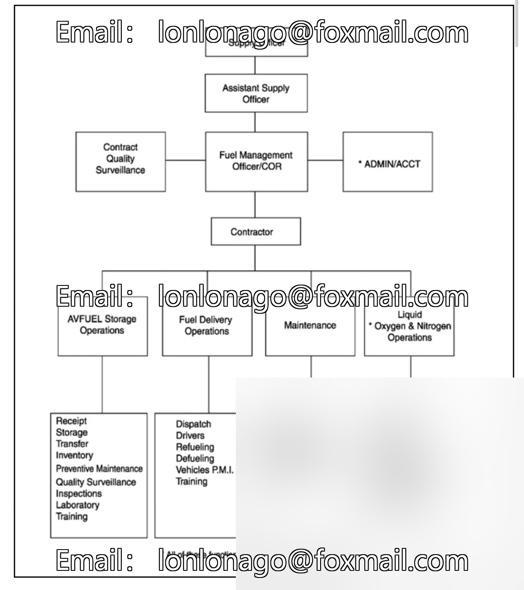
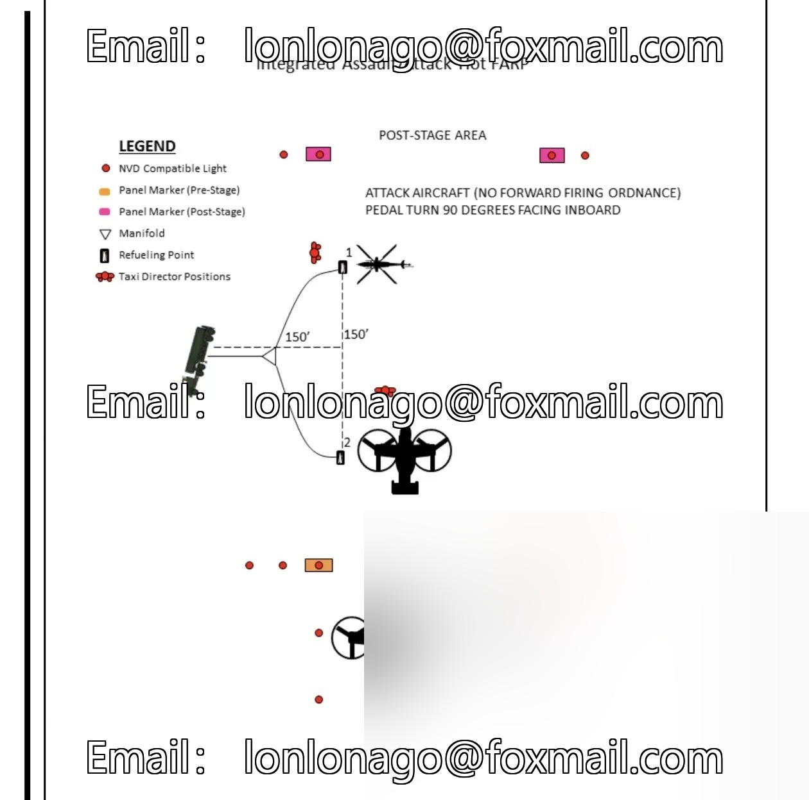
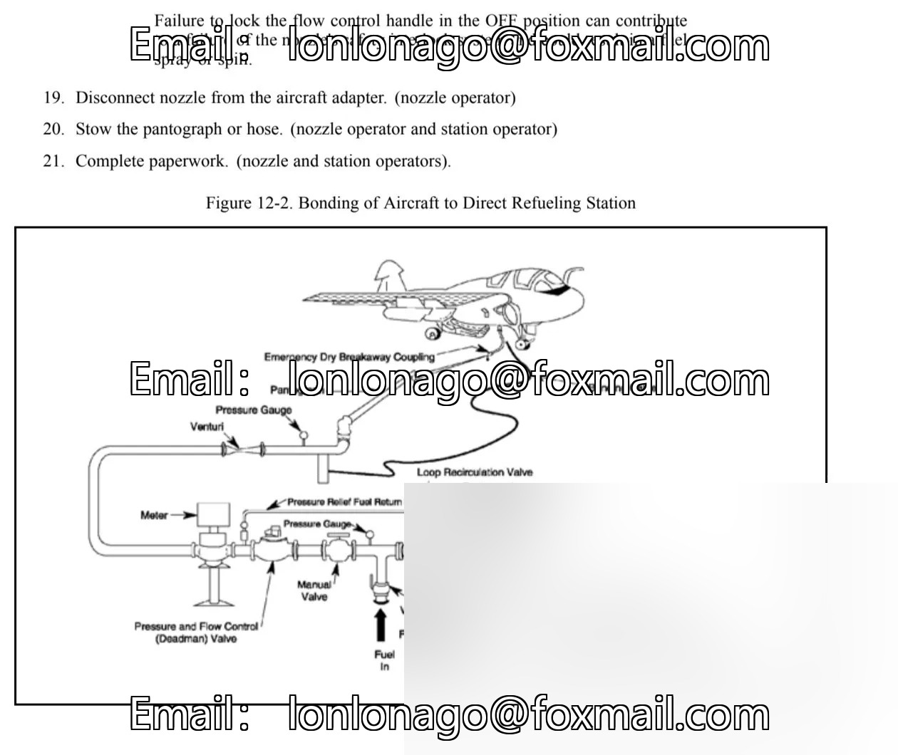

# Regarding U.S. Navy aircraft refueling (Aircraft Refueling)

## Body

Regarding the standard operating procedure (SOP) manual for US Naval Aircraft Refueling
This manual is divided into three main parts (Part):

Part I - GENERAL

This part mainly introduces general knowledge, responsibilities, and management regulations.

Chapter 1: Introduction (Introduction)

Objectives, scope, organization of publications, abbreviations.

Chapter 2: Organization and Training Aboard Ships

Official training requirements, division of responsibilities (commanders, deck officers, fuel officers, etc.), local commands.

Part 2: Aviation refueling on ships (Part II - AIRCRAFT REFUELING ABOARD SHIPS)

This is the core practical part of the manual, which carefully specifies the procedure for refueling on a warship.

Chapter 3: Quality Surveillance of Aviation Fuel on Ships (Quality Surveillance)

Sampling program: sample containers, classification, storage, and transport.

Testing equipment and methods: laboratory equipment, visual testing, FSII (injection fuel heat stability index), sediment/pollutant/free water testing.

Chapter 4: Safety of fuel processing operations on a ship (Safety)

Fire-extinguishing sources (static, electrical equipment, heat sources), controlling steam concentration, extinguishing procedures, personal protective equipment (uniforms, deck shoes, etc.).

Chapter 5: Shipboard Aircraft Refueling System and Equipment

Refuel station (JP-5 system), hose, coupler, pressure fuel injection device, naval-property fuel lubricating cooling unit (HEP).

Chapter 6: Shipboard Fuel Injection Procedures (Shipboard Operating Procedures)

Cold oil-fueling (engagement circuit closed): pressure-oil-fueling, gravity-oil-fueling, truck-oil-fueling.

Heating the fuel (engine running): The helicopter is fed fuel under the support of the auxiliary power apparatus (APU).

Special circumstances: multi-source fuel refueling, tanker transportation operations, commercial contract helicopter support.

Third part: Aviation refueling during activities on land (Part III - AIRCRAFT REFUELING AT SHORE ACTIVITIES)

This section is specifically for oil sampling activities in land-based bases or non-shipboard environments.

Chapter 7: Beach Activities Facilities and Equipment (Facilities and Equipment)

Fuel storage tank, filter separator, hose, refuel vehicle, instrument.

Chapter 8: Onshore activities organization and training (Organization and Training)

Chapter 9: Quality Surveillance at Shore Activities

Storage tank fuel receiving test, sampling, and analysis.

Chapter 10: Safety in Shore Activity (Safety in Shore Activities)

Chapter 11: Operating Procedures for Shore Activities

Controlling spillage and leakage, using night vision, direct gas station operation, truck operation.

Chapter 12: Maintenance of Support Equipment

Filters/septa, tubing reels, pumps and maintenance periods and testing of these items.

The manual covers US Navy aircraft refueling standard operating procedures, including general principles, shipboard refueling, quality surveillance, safety operations and shipboard refueling systems.

<!-- AI_ENRICHED -->

## Images

## Payment

Here is a pay link on Stripe ( https://buy.stripe.com/3cs8yP7sY87d0vu9AB ). Please contact me lonlonago@foxmail.com after funding $89, and I will send you a complete data files , thank you!

